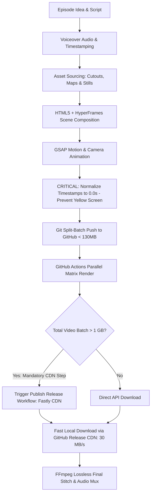

# History Vox-Style Animated Documentary: Complete Production Skill & Guide

This skill guides an AI agent through the complete lifecycle of creating **Vox/Johnny Harris-style historical animated documentaries** from concept to finalized 4K/1080p video, rendered for free using GitHub Actions cloud infrastructure with automatic CDN release publishing.

---

## 1. Aesthetic & Architectural DNA

A Vox-style documentary relies on a distinctive visual language:
1. **Textured Parchment Canvas**: `#f1e6c8` or `#ece1c3` paper texture background.
2. **Dynamic Animated Film Grain**: SVG noise filter with animated `feTurbulence` seed for high-end cinematic tactile feel.
3. **Transparent Historical Cutouts**: Transparent PNGs of figures, statues, and relics with paper drop-shadows (`filter: drop-shadow(0 15px 25px rgba(20, 15, 10, 0.4))`) and gentle hover/float micro-motions.
4. **Animated Vector Route Maps**: SVG paths drawn dynamically using GSAP `strokeDashoffset` and pulsating location pins.
5. **Kinetic Typography & Banners**: Paper-tape text highlights, typewriter captions, and stamp-like title cards.
6. **Virtual Camera Motion**: GSAP smooth panning and zooming on the `#stage` container to focus viewer attention.

---

## 2. Complete Production Workflow



---

## 3. Core DOM & Animation Architecture (`index.html`)

Every episode is a standalone HyperFrames composition container.

### Complete Working Minimal Template:

```html
<!DOCTYPE html>
<html lang="en">
<head>
  <meta charset="UTF-8">
  <title>Vox Style Episode</title>
  <style>
    * { box-sizing: border-box; margin: 0; padding: 0; }
    body { background: #111; display: flex; justify-content: center; align-items: center; min-height: 100vh; overflow: hidden; }
    
    #stage {
      position: relative;
      width: 1920px;
      height: 1080px;
      background: #f1e6c8; /* Parchment canvas */
      overflow: hidden;
      font-family: 'Cinzel', 'Georgia', serif;
    }

    /* Film Grain Overlay */
    #grain {
      position: absolute;
      top: 0; left: 0; width: 100%; height: 100%;
      pointer-events: none;
      opacity: 0.18;
      mix-blend-mode: multiply;
      z-index: 1000;
    }

    /* Visual Layers */
    .layer {
      position: absolute;
      top: 0; left: 0; width: 100%; height: 100%;
      will-change: transform, opacity;
    }

    .cutout {
      position: absolute;
      filter: drop-shadow(0 15px 25px rgba(20, 15, 10, 0.4));
      transform-origin: center bottom;
    }

    .banner {
      position: absolute;
      background: #2b1f14;
      color: #f7edd0;
      padding: 14px 28px;
      font-size: 32px;
      font-weight: 700;
      letter-spacing: 2px;
      text-transform: uppercase;
      box-shadow: 0 8px 20px rgba(0,0,0,0.3);
    }
  </style>
</head>
<body>
  <!-- STAGE: data-start is ALWAYS 0, duration is the episode length in seconds -->
  <div id="stage" data-composition-id="ep_01" data-start="0" data-duration="600.0" data-width="1920" data-height="1080">
    
    <!-- Film Grain Filter -->
    <svg id="grain" xmlns="http://www.w3.org/2000/svg">
      <filter id="noiseFilter">
        <feTurbulence type="fractalNoise" baseFrequency="0.8" numOctaves="3" stitchTiles="stitch"/>
      </filter>
      <rect width="100%" height="100%" filter="url(#noiseFilter)"/>
    </svg>

    <!-- Visual Scenes (data-start is LOCAL to this episode, e.g. 0.0s to 600.0s) -->
    <div class="layer" data-start="0.0" data-duration="15.0" id="scene-intro">
      
      <div class="banner" style="top: 200px; left: 150px;">The Rise of the Republic</div>
      
    </div>

  </div>

  <script src="assets/gsap.min.js"></script>
  <script>
    // Animation definition with LOCAL timestamps (0.0 to 600.0)
    window.ROME_DATA = {
      meta: { id: "ep_01", duration: 600.0 },
      beats: [
        {
          start: 0.0,
          end: 15.0,
          zoom: { at: 0.0, scale: 1.15, x: -50, y: -20, ease: "power2.out" }
        }
      ]
    };
  </script>
</body>
</html>
```

---

## 4. ⚠️ CRITICAL FAILURE: The "Yellow Screen Bug" (Videos 2 to 11)

### Symptom:
When rendering a sliced multi-part documentary:
- **Episode 1 renders perfectly** with rich visual maps, portraits, and kinetic banners (> 150,000 unique colors).
- **Episodes 2 through 11 produce large ~500 MB video files that display ONLY a flat, blank parchment yellow screen** with film grain noise.

### Root Cause:
The documentary was authored as one monolithic master timeline (e.g., $0\text{s}$ to $6,579\text{s}$). When sliced into episode folders:
- `rome_ep1` starts at $0.0\text{s}$.
- `rome_ep2` retains global timestamps: elements have `data-start="600.0"`, beats at $t \ge 600.0$.
- `rome_ep3` elements start at $t \ge 1200.0$.
- `rome_ep4..ep11` elements start at $1800\text{s}, 2400\text{s}, 3000\text{s}$, etc.

**Why HyperFrames Renders Yellow**:
HyperFrames evaluates each episode container `#stage` from local time $t = 0.0\text{s}$ to $t = 600.0\text{s}$. Because $t \in [0, 600]$, elements starting at $t \ge 600\text{s}$ never trigger. HyperFrames keeps all elements hidden (`display: none`), recording 10 minutes (18,000 frames) of pure `#stage` background color `#f1e6c8` with animated grain!

### The Non-Negotiable Rule:
**Every single episode HTML file MUST start its local timeline at $t = 0.0\text{s}$.**

$$\text{Episode Offset} = (\text{Episode Number} - 1) \times \text{Episode Duration}$$
$$\text{Local Time} = \max(0.0, \text{Global Time} - \text{Episode Offset})$$

---

## 5. Automated Pre-Render Normalization Script

Always run this script across all sliced episodes before committing and rendering:

```python
import os, json, re

def normalize_all_episodes(base_dir, ep_count=11, duration_per_ep=600.0):
    for ep in range(2, ep_count + 1):
        offset = (ep - 1) * duration_per_ep
        ep_dir = os.path.join(base_dir, f"rome_ep{ep}")
        html_path = os.path.join(ep_dir, "index.html")
        cues_path = os.path.join(ep_dir, "audio_cues.json")
        
        if not os.path.exists(html_path):
            continue

        with open(html_path, "r", encoding="utf-8") as f:
            html = f.read()

        # Preserve opening <div id="stage" ...> tag
        stage_idx = html.find('id="stage"')
        close_stage = html.find('>', stage_idx)
        head_part = html[:close_stage + 1]
        body_part = html[close_stage + 1:]

        # 1. Normalize data-start in HTML body
        def repl_start(m):
            val = float(m.group(1))
            new_val = max(0.0, round(val - offset, 2))
            return f'data-start="{new_val:.2f}"'

        body_part = re.sub(r'data-start="([\d\.]+)"', repl_start, body_part)

        # 2. Normalize JSON timestamps in window.ROME_DATA
        json_m = re.search(r'window\.ROME_DATA=(\{.*?\});</script>', body_part)
        if json_m:
            data = json.loads(json_m.group(1))
            def norm_obj(obj):
                if isinstance(obj, dict):
                    for k, v in list(obj.items()):
                        if k in ["start", "end", "at", "until"] and isinstance(v, (int, float)):
                            if v >= offset * 0.5:
                                obj[k] = round(max(0.0, v - offset), 2)
                        else:
                            norm_obj(v)
                elif isinstance(obj, list):
                    for it in obj: norm_obj(it)
            norm_obj(data)
            new_json_str = "window.ROME_DATA=" + json.dumps(data, separators=(',', ':')) + ";</script>"
            body_part = body_part[:json_m.start()] + new_json_str + body_part[json_m.end():]

        with open(html_path, "w", encoding="utf-8") as f:
            f.write(head_part + body_part)

        # 3. Normalize audio SFX cue timestamps
        if os.path.exists(cues_path):
            with open(cues_path, "r", encoding="utf-8") as f:
                cues = json.load(f)
            for it in cues:
                if "t" in it and isinstance(it["t"], (int, float)) and it["t"] >= offset * 0.5:
                    it["t"] = round(max(0.0, it["t"] - offset), 2)
            with open(cues_path, "w", encoding="utf-8") as f:
                json.dump(cues, f, indent=1)
        
        print(f"✅ Episode {ep} normalized successfully with offset -{offset}s!")

if __name__ == "__main__":
    normalize_all_episodes("./RomeDocumentary")
```

---

## 6. 🚀 MANDATORY ARCHITECTURE: GitHub CDN Release Publishing for Batches > 1 GB

### The Large Batch Problem:
When rendering multi-part video series (e.g. 11 episodes = ~3.5 GB total):
1. **Raw Artifact Limitations**: GitHub Actions stores raw build artifacts in **Microsoft Azure Blob Storage** (`*.blob.core.windows.net`).
2. **Terminal Choke**: Azure Blob Storage raw storage servers suffer severe international ISP throttling and packet drop (~1 KB/s download speed, taking 90+ hours).
3. **401 Unauthorized Bug**: Python `urllib` passes GitHub bearer authentication tokens across the 302 redirect to Azure, causing immediate `401 Unauthorized` errors.

### The CDN Solution:
Whenever total video output **exceeds 1 GB**, **DO NOT download raw artifacts directly to local machine**.
Instead, **ALWAYS publish the rendered episodes to a GitHub Release**.

#### Why GitHub Releases?
* Delivered via **Fastly / GitHub Global CDN (`github.com/releases/download/...`)**.
* Completely bypasses Azure Blob Storage throttling.
* Downloads at full internet connection speed (**25–35 MB/s** vs. 1 KB/s).
* Supports HTTP Range resume (`curl -C -`) so partial downloads never restart from zero.

---

## 7. Cloud Packaging Workflow (`publish_release.yml`)

Save this workflow to `.github/workflows/publish_release.yml`:

```yaml
name: Publish Rendered Episodes to GitHub Release

on:
  workflow_dispatch:
    inputs:
      run_id:
        description: 'Workflow Run ID with Rendered Artifacts'
        required: true
      release_tag:
        description: 'Release Tag Name'
        required: true
        default: 'v1.0.0-rome-documentary'

permissions:
  contents: write

jobs:
  publish_release:
    name: Package and Publish Release
    runs-on: ubuntu-latest

    steps:
      - name: Checkout Code
        uses: actions/checkout@v4

      - name: Download Artifacts from Cloud Run
        env:
          GH_TOKEN: ${{ secrets.GITHUB_TOKEN }}
        run: |
          echo "Downloading artifacts from run ${{ github.event.inputs.run_id }}..."
          gh run download ${{ github.event.inputs.run_id }} --dir ./artifacts_download
          
          echo "Flattening MP4 video files into release_files/..."
          mkdir -p ./release_files
          find ./artifacts_download -name "*.mp4" -exec cp {} ./release_files/ \;
          ls -lh ./release_files/

      - name: Create GitHub Release with Direct CDN Links
        env:
          GH_TOKEN: ${{ secrets.GITHUB_TOKEN }}
        run: |
          TAG="${{ github.event.inputs.release_tag }}"
          
          # Delete existing release/tag if already exists
          gh release delete "$TAG" -y 2>/dev/null || true
          git tag -d "$TAG" 2>/dev/null || true
          git push origin :refs/tags/"$TAG" 2>/dev/null || true

          echo "Creating Release $TAG with all rendered episodes..."
          gh release create "$TAG" ./release_files/*.mp4 \
            --title "Rome Documentary 110-Min (All Rendered Episodes)" \
            --notes "Full historical documentary rendered with normalized local timelines (t=0.0s). Delivered via Fastly CDN for fast line-speed downloading."
```

---

## 8. Fast Resumable Downloader Script (`download_release_episodes.py`)

Run locally to download all episodes from the GitHub CDN Release at full speed:

```python
#!/usr/bin/env python3
import os, sys, subprocess, urllib.request, json, re

OUTPUT_DIR = os.path.abspath("rendered_outputs")
os.makedirs(OUTPUT_DIR, exist_ok=True)

RELEASE_TAG = "v1.0.0-rome-documentary"
REPO = "bosselon916-crypto/hyperframe-rendering"

print(f"📡 Fetching Release assets from {REPO} ({RELEASE_TAG})...")
api_url = f"https://api.github.com/repos/{REPO}/releases/tags/{RELEASE_TAG}"

req = urllib.request.Request(api_url, headers={"User-Agent": "Mozilla/5.0"})
with urllib.request.urlopen(req) as resp:
    data = json.loads(resp.read().decode())

assets = data.get("assets", [])
def ep_sort(a):
    nums = re.findall(r'\d+', a["name"])
    return int(nums[0]) if nums else 999

sorted_assets = sorted(assets, key=ep_sort)
print(f"📦 Found {len(sorted_assets)} MP4 episode files in release.\n")

for idx, a in enumerate(sorted_assets, 1):
    name = a["name"]
    url = a["browser_download_url"]
    expected_size = a["size"]
    dest_path = os.path.join(OUTPUT_DIR, name)

    # Skip if already downloaded
    if os.path.exists(dest_path) and os.path.getsize(dest_path) >= expected_size:
        print(f"[{idx}/{len(sorted_assets)}] ✅ {name} already complete. Skipping.")
        continue

    print(f"[{idx}/{len(sorted_assets)}] ⬇️ Downloading {name} ({expected_size / 1e6:.1f} MB)...")
    cmd = ["curl", "-L", "-C", "-", "--progress-bar", url, "-o", dest_path]
    subprocess.run(cmd)

print(f"\n🎉 All episodes successfully downloaded to {OUTPUT_DIR}/!")
```

---

## 9. Final Lossless Stitch & Visual Verification

1. **Lossless Merge Command**:
```bash
ffmpeg -f concat -safe 0 -i templates/concat_list.txt -c copy full_documentary_silent.mp4
```

2. **Frame Diversity Verification Test**:
Run this test on any rendered episode to verify that graphics are actively rendering and not stuck on a blank yellow canvas:
```bash
ffmpeg -ss 00:00:25 -i rendered_outputs/rome_ep2_silent.mp4 -vframes 1 -q:v 2 /tmp/verify.jpg -y && \
python3 -c "
from PIL import Image
im = Image.open('/tmp/verify.jpg')
colors = len(set(im.getdata()))
print(f'Unique colors: {colors}')
assert colors > 5000, 'FAIL: Blank/yellow screen detected!'
print('SUCCESS: Rich animation confirmed!')
"
```
*(> 10,000 unique colors = rich graphics; < 500 = blank canvas failure)*

---

## Production Checklist

- [ ] Every episode has `#stage data-start="0"` and elements normalized to $0.0\text{s}$ (No global offsets).
- [ ] Run `normalize_timestamps.py` before committing.
- [ ] Git commits chunked under 130MB to avoid GitHub HTTPS push limits.
- [ ] Run GitHub Actions render matrix.
- [ ] **Batches > 1 GB**: Trigger `publish_release.yml` to package files onto Fastly CDN.
- [ ] Download via `download_release_episodes.py` at 30 MB/s line speed.
- [ ] Verify color count > 5,000 on sample frames.
- [ ] Stitch losslessly with FFmpeg `-c copy`.
