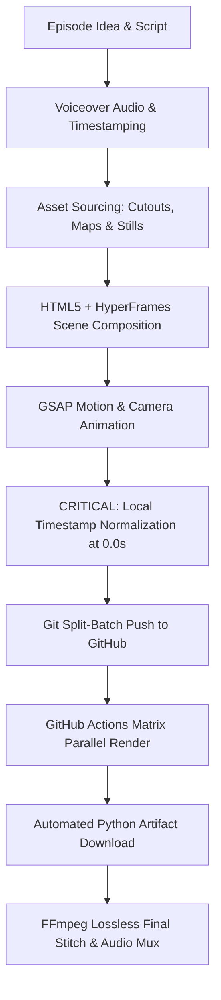

# History Vox-Style Animated Documentary: Complete Production Skill & Guide

This skill guides an AI agent through the complete lifecycle of creating **Vox/Johnny Harris-style historical animated documentaries** from concept to finalized 4K/1080p video, rendered for free using GitHub Actions cloud infrastructure.

---

## 1. Aesthetic & Architectural DNA

A Vox-style documentary relies on a distinctive visual language:
1. **Textured Parchment Canvas**: `#f1e6c8` or `#ece1c3` paper texture background.
2. **Dynamic Animated Film Grain**: SVG noise filter with animated `feTurbulence` seed for high-end cinematic tactile feel.
3. **Transparent Historical Cutouts**: Transparent PNGs of figures, statues, and relics with paper drop-shadows (`filter: drop-shadow(0 15px 25px rgba(0,0,0,0.35))`) and gentle hover/float micro-motions.
4. **Animated Vector Route Maps**: SVG paths drawn dynamically using GSAP `strokeDashoffset` and pulsating location pins.
5. **Kinetic Typography & Banners**: Paper-tape text highlights, typewriter captions, and stamp-like title cards.
6. **Virtual Camera Motion**: GSAP smooth panning and zooming on the `#stage` container to focus viewer attention.

---

## 2. The Complete Production Pipeline



---

## 3. Core DOM & Animation Architecture (`index.html`)

Every episode is a standalone HyperFrames composition container.

### Complete Working Minimal Template:

```html
<!DOCTYPE html>
<html lang="en">
<head>
  <meta charset="UTF-8">
  <title>Vox Style Episode</title>
  <style>
    * { box-sizing: border-box; margin: 0; padding: 0; }
    body { background: #111; display: flex; justify-content: center; align-items: center; min-height: 100vh; overflow: hidden; }
    
    #stage {
      position: relative;
      width: 1920px;
      height: 1080px;
      background: #f1e6c8;
      overflow: hidden;
      font-family: 'Cinzel', 'Georgia', serif;
    }

    /* Film Grain Overlay */
    #grain {
      position: absolute;
      top: 0; left: 0; width: 100%; height: 100%;
      pointer-events: none;
      opacity: 0.18;
      mix-blend-mode: multiply;
      z-index: 1000;
    }

    /* Visual Layers */
    .layer {
      position: absolute;
      top: 0; left: 0; width: 100%; height: 100%;
      will-change: transform, opacity;
    }

    .cutout {
      position: absolute;
      filter: drop-shadow(0 15px 25px rgba(20, 15, 10, 0.4));
      transform-origin: center bottom;
    }

    .banner {
      position: absolute;
      background: #2b1f14;
      color: #f7edd0;
      padding: 14px 28px;
      font-size: 32px;
      font-weight: 700;
      letter-spacing: 2px;
      text-transform: uppercase;
      box-shadow: 0 8px 20px rgba(0,0,0,0.3);
    }
  </style>
</head>
<body>
  <!-- STAGE: data-start is ALWAYS 0, duration is the episode length in seconds -->
  <div id="stage" data-composition-id="ep_01" data-start="0" data-duration="600.0" data-width="1920" data-height="1080">
    
    <!-- Film Grain Filter -->
    <svg id="grain" xmlns="http://www.w3.org/2000/svg">
      <filter id="noiseFilter">
        <feTurbulence type="fractalNoise" baseFrequency="0.8" numOctaves="3" stitchTiles="stitch"/>
      </filter>
      <rect width="100%" height="100%" filter="url(#noiseFilter)"/>
    </svg>

    <!-- Visual Scenes (data-start is LOCAL to this episode, e.g. 0.0s to 600.0s) -->
    <div class="layer" data-start="0.0" data-duration="15.0" id="scene-intro">
      
      <div class="banner" style="top: 200px; left: 150px;">The Rise of the Republic</div>
      
    </div>

  </div>

  <script src="assets/gsap.min.js"></script>
  <script>
    // Animation definition with LOCAL timestamps (0.0 to 600.0)
    window.ROME_DATA = {
      meta: { id: "ep_01", duration: 600.0 },
      beats: [
        {
          start: 0.0,
          end: 15.0,
          zoom: { at: 0.0, scale: 1.15, x: -50, y: -20, ease: "power2.out" }
        }
      ]
    };
  </script>
</body>
</html>
```

---

## 4. ⚠️ CRITICAL RULE: Local vs. Absolute Timestamps

### The Yellow Screen Bug (and how to prevent it):
When a multi-episode documentary (e.g. 110 minutes total) is sliced into separate episode HTML files:
- **WRONG**: Retaining global master timestamps (e.g. Episode 2 starting at `600s`, Episode 3 at `1200s`).
  - Because HyperFrames renders each episode stage from $t = 0.0\text{s}$ to $600.0\text{s}$, elements set to `data-start="600.0"` will **never appear**. The camera records 10 minutes of flat background parchment yellow!
- **CORRECT**: Every episode file **MUST start its timeline at `0.0s`**.

### The Normalization Formula:
For episode $N$ (where each episode is $D$ seconds long, e.g. $D = 600.0\text{s}$):
$$\text{Offset} = (N - 1) \times D$$
$$\text{Local Time} = \max(0.0, \text{Global Time} - \text{Offset})$$

This offset must be subtracted from:
1. Every HTML element attribute: `data-start="X"` inside `#stage`.
2. Every timestamp in `window.ROME_DATA`: `start`, `end`, `at`, `until` in `beats`, `cast`, `teach`, `captions`, `banners`, `routes`, `maps`.
3. Every audio SFX cue `t` in `audio_cues.json`.

---

## 5. Automated Timestamp Normalizer Script

Save this script as `normalize_timestamps.py` in the documentary root folder:

```python
import os, json, re

def normalize_all_episodes(base_dir, ep_count=11, duration_per_ep=600.0):
    for ep in range(2, ep_count + 1):
        offset = (ep - 1) * duration_per_ep
        ep_dir = os.path.join(base_dir, f"rome_ep{ep}")
        html_path = os.path.join(ep_dir, "index.html")
        cues_path = os.path.join(ep_dir, "audio_cues.json")
        
        if not os.path.exists(html_path):
            continue

        with open(html_path, "r", encoding="utf-8") as f:
            html = f.read()

        stage_idx = html.find('id="stage"')
        close_stage = html.find('>', stage_idx)
        head_part = html[:close_stage + 1]
        body_part = html[close_stage + 1:]

        # 1. Normalize data-start in HTML
        def repl_start(m):
            val = float(m.group(1))
            new_val = max(0.0, round(val - offset, 2))
            return f'data-start="{new_val:.2f}"'

        body_part = re.sub(r'data-start="([\d\.]+)"', repl_start, body_part)

        # 2. Normalize JSON timestamps
        json_m = re.search(r'window\.ROME_DATA=(\{.*?\});</script>', body_part)
        if json_m:
            data = json.loads(json_m.group(1))
            def norm_obj(obj):
                if isinstance(obj, dict):
                    for k, v in list(obj.items()):
                        if k in ["start", "end", "at", "until"] and isinstance(v, (int, float)):
                            if v >= offset * 0.5:
                                obj[k] = round(max(0.0, v - offset), 2)
                        else:
                            norm_obj(v)
                elif isinstance(obj, list):
                    for it in obj: norm_obj(it)
            norm_obj(data)
            new_json_str = "window.ROME_DATA=" + json.dumps(data, separators=(',', ':')) + ";</script>"
            body_part = body_part[:json_m.start()] + new_json_str + body_part[json_m.end():]

        with open(html_path, "w", encoding="utf-8") as f:
            f.write(head_part + body_part)

        # 3. Normalize audio cues
        if os.path.exists(cues_path):
            with open(cues_path, "r", encoding="utf-8") as f:
                cues = json.load(f)
            for it in cues:
                if "t" in it and isinstance(it["t"], (int, float)) and it["t"] >= offset * 0.5:
                    it["t"] = round(max(0.0, it["t"] - offset), 2)
            with open(cues_path, "w", encoding="utf-8") as f:
                json.dump(cues, f, indent=1)
        
        print(f"✅ Episode {ep} normalized successfully with offset -{offset}s!")

if __name__ == "__main__":
    normalize_all_episodes("./RomeDocumentary")
```

---

## 6. GitHub Actions Cloud Rendering ($0 Cost)

Render 11 episodes in parallel for free using GitHub standard Ubuntu runners.

### Workflow File: `.github/workflows/render.yml`

```yaml
name: Render Rome Episodes (HyperFrames)

on:
  workflow_dispatch:
    inputs:
      quality:
        description: 'Render Quality'
        required: true
        default: 'draft'
        type: choice
        options:
          - draft
          - high

jobs:
  render_episodes:
    name: Render Episode ${{ matrix.episode }}
    runs-on: ubuntu-latest
    strategy:
      fail-fast: false
      matrix:
        # All 11 episodes rendered concurrently in parallel
        episode: [1, 2, 3, 4, 5, 6, 7, 8, 9, 10, 11]

    steps:
      - name: Checkout Code
        uses: actions/checkout@v4

      - name: Setup Node.js 22
        uses: actions/setup-node@v4
        with:
          node-version: 22

      - name: Setup FFmpeg (Static Binary)
        uses: federicocarboni/setup-ffmpeg@v3

      - name: Install Browser Dependencies & HyperFrames
        run: |
          npx playwright install-deps chromium
          npm install -g hyperframes@0.8.198
          hyperframes browser ensure

      - name: Render Episode ${{ matrix.episode }}
        run: |
          cd "RomeDocumentary/rome_ep${{ matrix.episode }}"
          hyperframes render --quality ${{ github.event.inputs.quality || 'draft' }} --output "../../rome_ep${{ matrix.episode }}_silent.mp4"

      - name: Upload Rendered Video Artifact
        uses: actions/upload-artifact@v4
        with:
          name: rome_ep${{ matrix.episode }}_silent
          path: rome_ep${{ matrix.episode }}_silent.mp4
          retention-days: 7
```

---

## 7. Git Push Safety: Handling 100MB+ Batches

GitHub HTTPS pushes fail with `RPC failed; HTTP 400` if the payload exceeds ~150-200MB.
Always push multi-episode documentary assets in small split batches:
```bash
# Batch 1: Workflow + Episodes 4 to 7 (~110MB)
git add .github/ RomeDocumentary/rome_ep4/ RomeDocumentary/rome_ep5/ RomeDocumentary/rome_ep6/ RomeDocumentary/rome_ep7/
git commit -m "Add workflow and episodes 4-7"
git push origin main

# Batch 2: Episodes 8 to 11 (~110MB)
git add RomeDocumentary/rome_ep8/ RomeDocumentary/rome_ep9/ RomeDocumentary/rome_ep10/ RomeDocumentary/rome_ep11/
git commit -m "Add episodes 8-11"
git push origin main

# Batch 3: Episodes 1 to 3 (~120MB)
git add RomeDocumentary/rome_ep1/ RomeDocumentary/rome_ep2/ RomeDocumentary/rome_ep3/
git commit -m "Add episodes 1-3"
git push origin main
```

---

## 8. Automated Python Downloader Script

Save this script as `download_from_github.py` or `download_from_github.sh`. It queries the GitHub API, retrieves the latest artifact for each episode, and downloads them directly to `rendered_outputs/`:

```python
#!/usr/bin/env python3
import os
import sys
import json
import urllib.request
import zipfile
import subprocess

OUTPUT_DIR = os.path.abspath("rendered_outputs")
os.makedirs(OUTPUT_DIR, exist_ok=True)

# 1. Fetch GitHub Token from local git keychain or env var
token = os.environ.get("GITHUB_TOKEN")
if not token:
    try:
        token = subprocess.check_output(
            "printf 'protocol=https\\nhost=github.com\\n\\n' | git credential fill 2>/dev/null | grep '^password=' | cut -d= -f2",
            shell=True
        ).decode().strip()
    except Exception:
        pass

if not token:
    print("❌ Error: GitHub Token not found. Set GITHUB_TOKEN or authenticate git.")
    sys.exit(1)

# Detect repo from git remote
remote_url = subprocess.check_output("git config --get remote.origin.url", shell=True).decode().strip()
repo = remote_url.replace("https://github.com/", "").replace(".git", "")

print(f"📡 Querying GitHub Artifacts API for repository: {repo}...")
req = urllib.request.Request(
    f"https://api.github.com/repos/{repo}/actions/artifacts?per_page=100",
    headers={"Authorization": f"Bearer {token}", "Accept": "application/vnd.github+json"}
)

with urllib.request.urlopen(req) as resp:
    data = json.loads(resp.read().decode())

artifacts = data.get("artifacts", [])
latest_by_name = {}
for a in artifacts:
    name = a["name"]
    if name not in latest_by_name or a["created_at"] > latest_by_name[name]["created_at"]:
        latest_by_name[name] = a

def ep_sort_key(name):
    try:
        return int(re.search(r'\d+', name).group())
    except:
        return 999

import re
sorted_names = sorted(latest_by_name.keys(), key=ep_sort_key)
print(f"📦 Found {len(sorted_names)} unique episode artifacts to download.\n")

for idx, name in enumerate(sorted_names, 1):
    art = latest_by_name[name]
    aid = art["id"]
    dest_mp4 = os.path.join(OUTPUT_DIR, f"{name}.mp4")
    tmp_zip = f"/tmp/{name}.zip"

    print(f"[{idx}/{len(sorted_names)}] Downloading {name} (ID: {aid}, Size: {art['size_in_bytes'] / 1e6:.1f} MB)...")
    dl_req = urllib.request.Request(
        f"https://api.github.com/repos/{repo}/actions/artifacts/{aid}/zip",
        headers={"Authorization": f"Bearer {token}", "Accept": "application/vnd.github+json"}
    )
    with urllib.request.urlopen(dl_req) as dl_resp, open(tmp_zip, "wb") as f_out:
        f_out.write(dl_resp.read())

    with zipfile.ZipFile(tmp_zip, "r") as z:
        z.extractall(OUTPUT_DIR)
    if os.path.exists(tmp_zip):
        os.remove(tmp_zip)
    print(f"   -> Successfully extracted to {dest_mp4}")

print("\n🎉 All episodes successfully downloaded to rendered_outputs/!")
```

---

## 9. Final Lossless Concat & Audio Mux

Merge all silent episode videos into one continuous master documentary in seconds without re-encoding:

1. Create `concat_list.txt`:
```plaintext
file 'rendered_outputs/rome_ep1_silent.mp4'
file 'rendered_outputs/rome_ep2_silent.mp4'
file 'rendered_outputs/rome_ep3_silent.mp4'
file 'rendered_outputs/rome_ep4_silent.mp4'
file 'rendered_outputs/rome_ep5_silent.mp4'
file 'rendered_outputs/rome_ep6_silent.mp4'
file 'rendered_outputs/rome_ep7_silent.mp4'
file 'rendered_outputs/rome_ep8_silent.mp4'
file 'rendered_outputs/rome_ep9_silent.mp4'
file 'rendered_outputs/rome_ep10_silent.mp4'
file 'rendered_outputs/rome_ep11_silent.mp4'
```

2. Run Lossless Merge:
```bash
ffmpeg -f concat -safe 0 -i concat_list.txt -c copy full_documentary_silent.mp4
```

3. Mux Final Audio:
```bash
ffmpeg -i full_documentary_silent.mp4 -i full_narration_mix.m4a -c:v copy -c:a aac -b:a 320k full_documentary_final.mp4
```

---

## Summary Checklist for Any Agent

- [ ] Does `#stage` have `data-start="0"` and `data-duration="EPISODE_SECONDS"`?
- [ ] Are all elements inside `#stage` normalized to start at `0.0s` (no global offsets)?
- [ ] Are all `window.ROME_DATA` timestamps (`start`, `end`, `at`, `until`) within $[0.0, \text{duration}]$?
- [ ] Are git commits chunked under 130MB before pushing to GitHub?
- [ ] Did GitHub Actions run with `federicocarboni/setup-ffmpeg@v3` and `npx playwright install-deps chromium`?
- [ ] Was the dynamic downloader run to retrieve artifacts into `rendered_outputs/`?
- [ ] Was the final video merged losslessly with `-c copy`?
